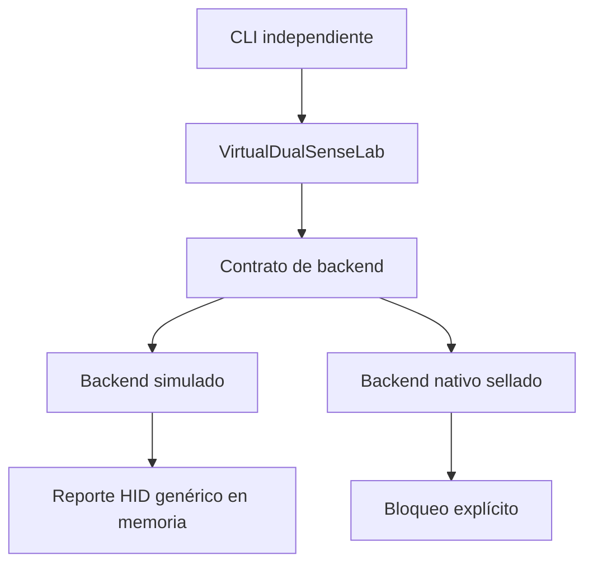

# Arquitectura de Virtual DualSense Lab Alpha 1

## Límite de aislamiento

Alpha 1 es un paquete Python independiente. Ningún archivo original de la base
2.9.8.9 importa el laboratorio. `main.py`, PySide6, `ConnectionManager`,
`EmulatorManager`, ViGEm, HidHide, perfiles y configuraciones permanecen fuera
del flujo experimental.

El reporte del simulador nunca cruza hacia Windows. Solo se conserva como bytes
en memoria para verificar mapeo, límites y orden.

## Componentes actuales

| Componente | Responsabilidad | Salida al SO |
| --- | --- | --- |
| `model.py` | Estado inmutable y validación de controles | No |
| `hid_report.py` | Descriptor candidato y codec de 16 bytes | No |
| `backend.py` | Contrato, estados, snapshots y errores | No |
| `simulated.py` | Ciclo de vida, historial, métricas y fallos | No |
| `lab.py` | Serialización de productores y escenario Alpha 1 | No |
| `diagnostics.py` | Lecturas sanitizadas de viabilidad | No modifica |
| `native.py` | Bloquea el uso nativo no verificado | No |
| `cli.py` | Diagnóstico y autoprueba independientes | No |

## Contrato del reporte simulado

| Campo | Tamaño | Valores |
| --- | ---: | --- |
| Report ID | 1 byte | `1` |
| Botones | 2 bytes | 14 bits usados, 2 reservados |
| D-pad | 1 byte | `0..7`, centro `8` |
| Sticks | 8 bytes | cuatro enteros con signo de 16 bits |
| L2/R2 | 4 bytes | dos enteros sin signo de 16 bits |

El descriptor usa Generic Desktop/Game Pad. No contiene identidad de Sony y no
se declara compatible con el protocolo DualSense.

## Arquitectura candidata para una fase nativa

La opción inicial preferida es un driver KMDF fuente HID sobre Virtual HID
Framework (VHF). UDE solo se justificaría si las pruebas demuestran que la pila
USB completa es indispensable.

Una fase posterior deberá separar:

1. Cliente de usuario sin privilegios que valida y serializa estados.
2. Canal IPC con ACL estricta, versión de protocolo y tamaños máximos.
3. Driver KMDF/VHF mínimo, sin lógica de perfiles ni interfaz.
4. Watchdog en kernel que neutralice entradas al perder el cliente.
5. Instalador firmado, explícito, reversible y separado del instalador estable.

Antes de escribir ese driver deben existir Windows 11 x64 de prueba, WDK,
Driver Verifier, pruebas HVCI/Secure Boot activas, estrategia de firma mediante
Microsoft Partner Center y revisión independiente del protocolo e identidad.

