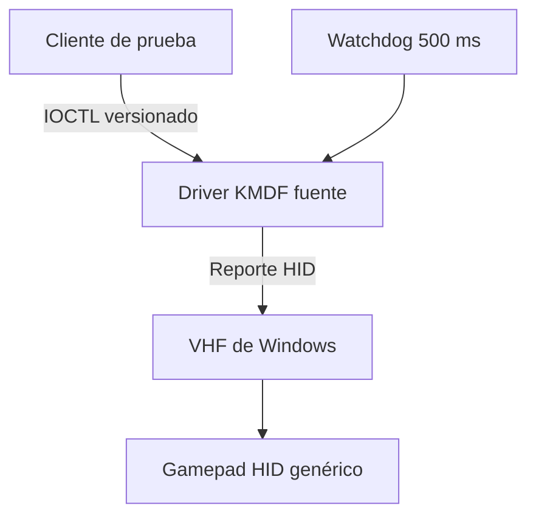

# Arquitectura — Virtual HID Enumeration Prototype Alpha 2

## Objetivo verificable

Alpha 2 agrega una implementación fuente que, después de compilarse y firmarse
correctamente, pretende enumerar un gamepad HID genérico mediante Virtual HID
Framework. El código no se integra con la aplicación estable ni afirma que el
dispositivo ya fue enumerado.

## Límites

| Capa | Estado Alpha 2 | Privilegios |
| --- | --- | --- |
| Simulador Python | Funcional | Usuario normal |
| Codec de 16 bytes | Funcional y probado | Ninguno |
| Cliente C++ | Fuente, no compilado aquí | Administrador por ACL |
| Driver KMDF/VHF | Fuente, no compilado aquí | Kernel |
| INF | Fuente, sin CAT ni firma | No se instala |
| Dispositivo HID | No enumerado ni verificado | No aplica |

## Descriptor de entrada

El descriptor del driver coincide byte por byte con el descriptor probado por
el simulador.

| Campo | Bytes | Validación en kernel |
| --- | ---: | --- |
| Report ID | 1 | Debe ser `1` |
| Botones | 2 | 14 bits; dos reservados deben ser cero |
| D-pad | 1 | `0..7`; centro `8` |
| Sticks | 8 | Cuatro ejes firmados de 16 bits |
| L2/R2 | 4 | Dos valores sin signo de 16 bits |

No hay reportes de salida ni funciones. Por tanto, no existen vibración,
háptica, luces, audio, movimiento, contactos táctiles o gatillos adaptativos.

## Ciclo de vida del driver

1. KMDF crea el objeto de dispositivo.
2. Registra una interfaz PnP privada.
3. Crea una cola secuencial y un timer pasivo de un solo disparo.
4. Inicializa VHF con el descriptor genérico.
5. Llama `VhfCreate`, `VhfStart` y envía un reporte neutral.
6. Acepta un solo cliente y secuencias estrictamente crecientes.
7. Envía cada reporte válido con `VhfReadReportSubmit`.
8. Rearma el timer con cada entrada no neutral y neutraliza a los 500 ms sin actualización.
9. Neutraliza al cerrar el cliente y al entrar o salir de D0.
10. Detiene el timer y llama `VhfDelete(..., TRUE)` durante la limpieza.

## Frontera de seguridad

- El INF permite acceso solo a SYSTEM y administradores.
- La interfaz es exclusiva para evitar dos escritores.
- `METHOD_BUFFERED` evita conservar punteros de usuario.
- Todas las estructuras tienen tamaño fijo y versión de protocolo.
- Report ID, bits reservados, D-pad y secuencia se validan antes de llegar a VHF.
- El watchdog evita mantener controles presionados si el cliente falla.
- VID/PID permanecen en cero: identidad experimental sin suplantación.

La ACL administrativa es deliberadamente restrictiva para Alpha 2. Una fase
posterior necesitará un servicio de usuario controlado o una ACL por servicio;
no se ampliará acceso global desde el driver.

## Relación con la aplicación estable

El driver y el cliente están en `native/vhf`. Ningún módulo de `main.py`, `src`
o `gui` los importa. El instalador estable no contiene referencias al prototipo.
ViGEmBus e HidHide continúan bajo sus propietarios actuales y no son llamados
por esta arquitectura.

## Fuentes primarias

- [Virtual HID Framework](https://learn.microsoft.com/windows-hardware/drivers/hid/virtual-hid-framework--vhf-)
- [VHF_CONFIG_INIT](https://learn.microsoft.com/windows-hardware/drivers/ddi/vhf/nf-vhf-vhf_config_init)
- [VhfCreate](https://learn.microsoft.com/windows-hardware/drivers/ddi/vhf/nf-vhf-vhfcreate)
- [VhfReadReportSubmit](https://learn.microsoft.com/windows-hardware/drivers/ddi/vhf/nf-vhf-vhfreadreportsubmit)
- [VhfDelete](https://learn.microsoft.com/windows-hardware/drivers/ddi/vhf/nf-vhf-vhfdelete)
- [Interfaces de dispositivo WDF](https://learn.microsoft.com/windows-hardware/drivers/wdf/using-device-interfaces)

© Team Nikaido
